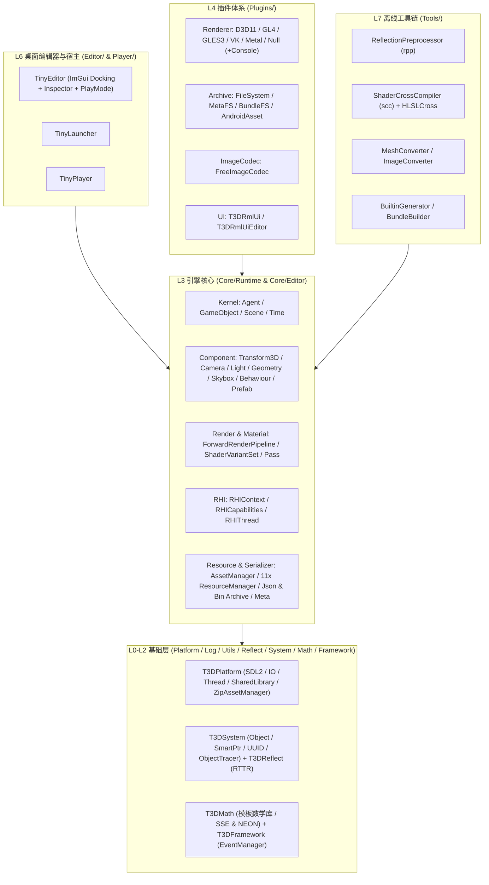
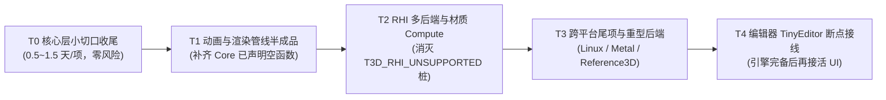

# Tiny3D 引擎能力全景与缺口分析报告

> **更新日期**：2026-10-23  
> **任务类型**：全引擎现状分析与设计对照（基于 `source/*`、`CMakeLists.txt` 及 `doc/todo/*` 源码级核验）  
> **定位**：盘点 Tiny3D 当前已落地的核心能力、各图形后端/平台真实完成度、设计文档与代码实现的偏差，并按 P0 / P1 / P2 梳理后续演进路线图。

---

## 0. 总体结论

Tiny3D 目前已经完成了从「**跨平台基础设施 → 全自动 RTTR 反射闭环 → 场景与组件模型 → 前向渲染管线与现代化 RHI → 离线资产工具链 → 运行时 UI → 桌面编辑器与 C++ 热重载**」的完整架构闭环。

近期一系列关键特性已落地合入主干：
1. **CMake 原生反射管线**（`ReflectionPreprocessor` + `Tiny3DReflectHelpers.cmake`，淘汰旧 `cct`/`nmake` 链路）；
2. **RHI Compute / UAV / StructuredBuffer / Instanced & Indirect Draw / GPU Readback**（A/B/C/D 四期共 26 项全部合入，D3D11 与 GL4/GLES3 已通过 `ComputeApp` 验证）；
3. **相机后处理效果链**（`CameraBehaviour` + `CameraEffectBehaviour` + 临时 RT 池 Ping-Pong 翻转 + MSAA Resolve）；
4. **RmlUi 6.3 运行时 UI 插件**（`UISystem` 接口 + `RmlCanvas` 组件 + BeforePostProcess/Overlay 双渲染阶段 + Stencil 裁剪）；
5. **HLSLCross 自研跨编译器**（用 `DXC + SPIRV-Cross` 完全替换已归档的 `ShaderConductor`）；
6. **编辑器 Play 模式与业务 C++ 插件热重载**（`PlayModeController` + `CppBuildSystem` 后台构建 + 影子拷贝防文件锁死 + 帧末安全点销毁重建）。

**当前核心短板**集中在两方面：
- **Gameplay 关键支撑子系统空白**：物理引擎（Physics 3D/2D）、音频系统（Audio）、TypeScript/V8 脚本运行时（路线 B）、动画状态机（Animator/BlendTree）尚无实现代码；
- **渲染画质与编辑器交互深度不足**：材质仍为 Blinn-Phong（无 PBR/IBL）、Scene 视口缺 3D Gizmo 手柄与点击拾取、编辑器无 Undo/Redo 命令栈，且 Metal 后端与 Linux/iOS 平台层仍有阻塞级缺口。

---

## 1. 模块分层与成熟度总览

| 层级 | 目录 / 目标名 | 成熟度 | 核心职责 | 代表入口文件 |
|------|---------------|--------|----------|--------------|
| **L0 平台与工具** | `Platform/` (`T3DPlatform`)、`Log/` (`T3DLog`)、`Utils/` (`T3DUtils`) | 生产可用（Win/Android/macOS） | 跨平台窗口、文件系统监控、线程池、定时器、动态库加载、`ZipAssetManager`、分级日志 | `source/Platform/Include/T3DPlatform.h` |
| **L1 对象与反射** | `System/` (`T3DSystem`)、`Reflect/` (`T3DReflect`)、`Math/` (`T3DMath`) | 生产可用 | `Object` 基类、侵入式 `SmartPtr`、`UUID`、`ObjectTracer`、`TCLASS`/`TPROPERTY` 反射宏、模板数学库 | `source/System/Include/T3DObject.h` |
| **L2 事件框架** | `Framework/` (`T3DFramework`) | 生产可用 | 同步 `sendEvent` / 异步 `postEvent`、单播/多播/广播、双缓冲事件队列与调用栈保护 | `source/Framework/Include/T3DEventManager.h` |
| **L3 引擎核心** | `Core/Runtime` (`T3DCore`)、`Core/Editor` (`T3DCoreEditor`) | 核心完备，高阶特性待扩 | `Agent` 帧循环、`GameObject`-`Component`、`ForwardRenderPipeline`、`RHIContext`、`AssetManager`、序列化与 `.meta` | `source/Core/Include/Kernel/T3DAgent.h` |
| **L4 插件生态** | `Plugins/Renderer`、`Archive`、`ImageCodec`、`RmlUi` | D3D11/GL4/GLES3/VK 可用 | 图形 API 后端、虚拟档案系统、FreeImage 纹理解码、RmlUi 6.3 运行时 UI | `source/Plugins/CMakeLists.txt` |
| **L5 运行时宿主** | `Player/` (`TinyPlayer`)、业务 `GamePlugin` | 基础可用 | 独立游戏运行器、业务 C++ 动态库插件模板 | `source/Player/PlayerApp.h` |
| **L6 桌面编辑器** | `Editor/TinyEditor`、`TinyLauncher`、`TinyImGui`、`ImGuiImpl` | 核心工作流打通 | 场景编辑、RTTR Inspector、C++ 异步编译与热重载、Play/Stop 闭环 | `source/Editor/TinyEditor/EditorApp.h` |
| **L7 离线工具链** | `Tools/*` (`rpp` / `scc` / `HLSLCross` / `mconv` / `imgconv` / `bgen` / `bundlebuilder`) | 生产可用 | AST 反射生成、DXC+SPIRV-Cross 跨编译、FBX 转换、纹理解码、内置资产与打包 | `source/Tools/CMakeLists.txt` |

---

## 2. 已具备能力详解（按六大技术域）

### 2.1 基础设施、反射与序列化（`Platform` / `System` / `Reflect` / `Serializer`）

- **全自动反射闭环**：
  - 构建期由 CMake（`source/CMake/Utils/Tiny3DReflectHelpers.cmake`）生成 `ReflectionSettings.json`，调用 `ReflectionPreprocessor (rpp)` 基于 Libclang 解析 AST，为 `T3DSystem`、`T3DMath`、`T3DCore`、`T3DCoreEditor`、`TinyEditor`、`TinyLauncher`、`T3DRmlUi` 自动生成 RTTR 注册代码。
  - **一处声明，三处复用**：基于 `RttrArchive`（`source/Core/Include/Serializer/T3DRttrArchive.h`）统一驱动 JSON（`JsonArchive`）/ 二进制（`BinArchive`）序列化、`Prefab` 属性覆盖对比以及编辑器 `UIInspectorWindow` 属性绘制。
- **内存与对象安全**：
  - 全继承自 `Object` 的侵入式引用计数（`SmartPtr<T>`），配合 `ObjectTracer` 追踪存活对象与内存泄漏。
  - 针对多线程 RHI 架构，`Agent::postFrameEndTask`（`source/Core/Include/Kernel/T3DAgent.h`）提供了帧末安全点任务队列，确保卸载场景、渲染目标或插件 DLL 时 RHI 线程已空闲且命令队列已排空（`drainRHICommands`）。
- **跨平台动态库与 APK 资产提取**：
  - `SharedLibrary` 统一封装 Windows `LoadLibrary` 与 POSIX `dlopen`（支持 `kSharedLibraryIsolated` 符号隔离与模块路径反查 `getModuleDir`）。
  - `ZipAssetManager` 解决 Android APK 内 `assets/plugins/` 下 `.so` 无法直接 `dlopen` 的问题，启动时自动提取至可写目录并加载。

### 2.2 场景、组件与 Gameplay 生命周期（`Core/Kernel` / `Component` / `Bound`）

- **GameObject-Component 体系（`source/Core/Include/Kernel/T3DGameObject.h`）**：
  - 支持按类型或类名增删查组件（`addComponent<T>` / `getComponent<T>` / `getComponents<T>`）、按 `Settings.updateOrders` 优先级分槽更新、整棵子树深拷贝 `clone()`。
  - 区分自身激活态 `isActive()`（对标 `activeSelf`）与层级激活态 `isActiveInHierarchy()`，换父或切换开关时自动同步子树 `Behaviour` 的 `onEnable` / `onDisable`。
- **完整 `Behaviour` 脚本生命周期（`source/Core/Include/Component/T3DBehaviour.h`）**：
  - 完整实现 `onAwake` → `onEnable` → `onStart`（延迟至首次 Update 前）→ `onFixedUpdate`（固定步长，单帧最多 8 步）→ `onUpdate` → `onLateUpdate` → `onDisable` → `onDestroy`（帧末延迟销毁）。
  - 支持 `executeInEditMode()`，允许特定组件（如 `RmlCanvas`）在编辑器非 Play 态下运行。
- **相机扩展钩子与后处理组件**：
  - `CameraBehaviour`（`onPreRender` / `onPostRender`）与 `CameraEffectBehaviour`（`onRenderImage(ctx, src, dst, depth)`，支持按 `EffectOrder` 稳定排序串联多个全屏后处理 Pass）。
- **Prefab 预制体与 Override 体系（`source/Core/Include/Component/T3DPrefabInstance.h`）**：
  - 支持预制体实例化、属性级修改记录（`PropertyModification`）、变体与 Unpack 操作，编辑器 Inspector 支持 Override 高亮与还原。
- **几何包围体与视锥剔除（`source/Core/Include/Bound/`）**：
  - 内置 `AabbBound`、`SphereBound`、`ObbBound`、`CapsuleBound`、`FrustumBound`，网格加载时可通过 `GameObject::seedBoundFromMesh` 自动播种剔除包围体，支持 `Camera::cullingMask` 与 `GameObject::cameraMask` 按位过滤。

### 2.3 渲染管线与材质着色器系统（`Core/Render` / `Material` / `Tools/HLSLCross`）

- **前向渲染管线（`source/Core/Source/Render/T3DForwardRenderPipeline.cpp`）**：
  - **阴影 Pass（`renderShadowMap`）**：提取场景首个方向光（`mImportantDirLight`），构建正交光空间矩阵并乘以后端 `getDepthRemapMatrix()`，绘制 `ShadowCaster` Pass 到 $2048 \times 2048$ `D24S8` 深度纹理，前向 Pass 中执行 $3 \times 3$ PCF 比较采样。
  - **前向 Pass（`renderForward`）**：按相机 → 渲染队列 → 材质分组绘制 `ForwardBase` Pass，支持 1 盏环境光、1 盏方向光、最多 4 盏点光源（`kMaxPointLights = 4`）与 4 盏聚光灯（`kMaxSpotLights = 4`）。
  - **天空盒绘制（`renderSkybox`）**：在不透明队列之后、透明队列之前，利用全屏三角形与 `inverse(VP)` 反投影绘制 Cubemap 天空盒，利用已有深度剔除被遮挡像素。
  - **后处理与全屏绘制（`runCameraPostprocessing` / `drawFullscreen`）**：内置按 `(width, height, format)` 分桶复用的临时 RT 池（`mTempRTPool`），自动处理 MSAA 源的 Resolve，串联执行相机上的 `CameraEffectBehaviour` 后再 Blit 回目标窗口。
- **多层材质与三维着色器变体（`Core/Material/`）**：
  - 采用 `Shader` → `Technique` → `Pass` → `ShaderVariantSet` 结构，变体按 `(UUID) × (Keyword 组合) × (Language)` 三维索引，运行时仅编译当前活动 RHI 对应语言的变体。
- **自研着色器跨编译链（`HLSLCross` + `scc`）**：
  - 基于 Flex/Bison 解析 `.shader` 文件，通过 `HLSLCross`（`DXC` 编译 HLSL 到 SPIR-V，再经 `SPIRV-Cross` 转译）一次性产出 `hlsl`、`glsl`、`essl`、`spirv`、`msl_macos`、`msl_ios` 变体，并结合 Console 渲染后端提取常量缓冲与采样器反射信息写入 `.tshader`。

### 2.4 RHI 抽象层与多图形后端（`Core/RHI` / `Plugins/Renderer`）

- **统一 RHI 契约（`source/Core/Include/RHI/T3DRHIContext.h`）**：
  - 包含 75+ 个纯虚接口，强制所有后端显式实现或通过 `T3D_RHI_UNSUPPORTED(capField)` 宏声明不支持（Debug 下自动断言 `getCapabilities().capField == false`，杜绝「假成功空壳」）。
  - **能力覆盖**：
    - 常规图形：RenderWindow / RenderTexture（含 Resize）、Blend / DepthStencil / Rasterizer / Sampler 状态、VB / IB / CB / PixelBuffer（1D/2D/3D/Cubemap）、6 个着色器阶段绑定、Blit / CopyBuffer / WriteBuffer；
    - 硬件实例化：`VertexAttribute::InputRate::kPerInstance` + `renderInstanced` / `renderIndexedInstanced`；
    - Compute 与 GPU-Driven：`StructuredBuffer`（`kStructured` / `kByteAddress` / `kTyped` + Counter/Append）、`set{VS,PS,CS}StructuredBuffers`、`setCSUnorderedAccessBuffers`、`dispatch` / `dispatchIndirect`、`uavBarrier`、`copyStructureCount`、`renderIndirect` / `renderIndexedIndirect`；
    - GPU 读回：`map`（`onRender` 内录制 Copy 到 Staging）+ `unmap`（`onPostRender` 内同步阻塞读回紧凑像素/缓冲数据）。

### 2.5 资源管理、动画与运行时 UI（`Core/Resource` / `Animation` / `Plugins/RmlUi`）

- **资源与档案体系**：
  - 11 类 `ResourceManager`（Mesh / SkinnedMesh / Skeleton / Animation / Material / Shader / Texture / Image / Prefab / Scene / Dylib）均支持 UUID 与文件名双索引缓存及 `unloadUnused` 引用计数回收。
  - `AssetManager`（`source/Core/Include/Resource/T3DAssetManager.h`）封装 `CompositeArchive` 搜索链，屏蔽底层是物理磁盘（`FileSystem`）、编辑器带 `.meta` 目录（`MetaFileSystem`）、打包产物（`BundleFileSystem`）还是 Android APK（`AndroidAsset`）。
- **骨骼动画**：
  - 支持 `Skeleton` 骨骼树、`AnimationClip` / `AnimationTrack` 关键帧插值，以及 `AnimationPlayer` 的 CPU 蒙皮（`CPUSkinning`）与 GPU 顶点着色器骨骼矩阵上传。
- **RmlUi 6.3 运行时 UI（`source/Plugins/RmlUi/`）**：
  - 实现 `UISystem` 接口（`T3DRmlUiSystem.h`），通过 `RmlRenderInterface` 对接 `RHIContext`，支持文字排版（FreeType）、纹理加载、2D 变换矩阵、Scissor 与 Stencil 几何裁剪；
  - 提供 `RmlCanvas` 组件，可在 Inspector 中配置 `.rml` 文档列表、排序优先级（`SortOrder`）、DPI 比例与渲染阶段（后处理前 `kBeforePostProcess` 或后处理后 `kOverlay`）。

### 2.6 桌面编辑器与验证示例集（`Editor/` / `Samples/`）

- **TinyEditor 桌面编辑器（`source/Editor/TinyEditor/`）**：
  - 具备 `UIHierarchyWindow`、`UISceneWindow`、`UIGameWindow`、`UIInspectorWindow`、`UIProjectWindow`、`UIPreferencesWindow` 及多语言支持；
  - `ImPropertyDrawer` 基于 RTTR 自动绘制基础类型、数学向量/颜色、枚举下拉框、数组容器与资产拖拽槽；
  - `PlayModeController` 实现完整的业务 C++ 插件后台编译、DLL 影子拷贝、热重载以及进入/退出 Play 模式的场景自动保存与还原。
- **18 个验证示例工程（`source/Samples/`）**：
  - 覆盖基础窗口（`HelloApp`）、数学与求交（`TransformationApp` / `IntersectionApp`）、相机（`CameraApp`）、几何体（`GeometryApp`）、纹理与读回（`TextureApp`）、场景（`SceneApp`）、四类光源与阴影（`DirectionalLightApp` / `PointLightApp` / `SpotLightApp` / `LightApp` / `ShadowApp`）、脚本组件（`BehaviourApp`）、相机后处理（`PostProcessingApp`）、输入（`InputApp`）、骨骼动画（`SkeletalAnimationApp`）、Bundle 资源加载（`ResourceApp`）、预制体（`PrefabApp`）、天空盒（`SkyboxApp`）、GPU 计算与间接绘制粒子（`ComputeApp`）以及运行时 UI（`RmlUiApp`）。

---

## 3. RHI 渲染后端与平台支持矩阵（代码实测口径）

### 3.1 渲染后端能力对照表

| RHI 能力项 | Direct3D 11 | OpenGL 4.3+ | OpenGL ES 3.1+ | Vulkan | Metal | Reference3D |
|------------|:-----------:|:-----------:|:--------------:|:------:|:-----:|:-----------:|
| **基础图形管线 (VB/IB/CB/State/Draw)** | ✅ 完整 | ✅ 完整 | ✅ 完整 | ✅ 完整 | ⚡ 骨架有 P0 冲突 | ❌ 旧架构无法编译 |
| **离屏 RT / MSAA Resolve / Blit** | ✅ 完整 | ✅ 完整 | ✅ 完整 | ✅ 完整 | ⚠️ 缺格式转换 Blit | ❌ 未实现 |
| **MRT 多渲染目标** | ✅ 最多 8 个 | ✅ 最多 8 个 | ✅ 最多 4/8 个 | ⚠️ 未完整接线 | ❌ 仅 `color[0]` | ❌ 未实现 |
| **Shader 运行时反射** | ✅ `D3DReflect` | ✅ `glslang` | ✅ `glslang`/离线 | ✅ `SPIRV-Reflect` | ❌ 空桩返回 OK | ❌ 未实现 |
| **硬件实例化 (`renderInstanced`)** | ✅ 含 BaseInst | ✅ 4.2+ BaseInst | ✅ `startInst=0` | ✅ 完整 | ✅ 已实现 | ❌ 未实现 |
| **结构化缓冲 (`StructuredBuffer`)** | ✅ 3 种形态齐全 | ✅ SSBO | ✅ SSBO (VS 按设备) | 🔇 Stub (待 E1) | 🔇 Stub (待 E3) | ❌ 未实现 |
| **Compute Dispatch + Buffer UAV** | ✅ CS 5.0 全量 | ✅ GL 4.3+ | ✅ ES 3.1+ | 🔇 Stub (待 E1) | 🔇 Stub (待 E3) | ❌ 未实现 |
| **纹理 UAV (`RWTexture2D`)** | ✅ 支持 (Mip 0) | ❌ 静默失效 | ❌ 静默失效 | 🔇 Stub | 🔇 Stub | ❌ 未实现 |
| **Indirect Draw + `copyStructureCount`** | ✅ 完整 | ✅ 完整 | ✅ 完整 | 🔇 Stub (待 E1) | 🔇 Stub (待 E3) | ❌ 未实现 |
| **GPU → CPU 读回 (`map` / `unmap`)** | ✅ 缓冲+全纹理 | ✅ 缓冲+纹理 | ✅ 缓冲+2D 彩色 | ✅ 缓冲+纹理 | ❌ 未实现 | ❌ 未实现 |
| **Console 无头反射后端 (供 `scc` 用)** | ✅ `D3D11Console` | ✅ `GL4Console` | ✅ 共用 `GL4Console` | ✅ `VKConsole` | ❌ 缺失 | ❌ 缺失 |

### 3.2 目标操作系统支持对照表

| 操作系统 | 平台抽象 (`T3DPlatform`) | 主力渲染后端 | 工具链 (`Tools/`) | 编辑器 (`TinyEditor`) | 当前主要阻塞点 |
|----------|--------------------------|--------------|-------------------|-----------------------|----------------|
| **Windows (x64)** | ✅ 完整（14+ Adapter） | D3D11 / GL4 / Vulkan | ✅ 全套可用 | ✅ 完整可用 | 无（主力开发与回归平台） |
| **Android (arm64)** | ✅ 完整（JNI + `ZipAssetManager`） | GLES3 / Vulkan | —（仅主机运行） | —（仅桌面） | 部分低端设备 GLES 3.1 不支持 VS 侧 SSBO（`ComputeApp` 已加 CPU 降级） |
| **macOS** | ✅ 完整（Cocoa + `UnixSharedLibrary`） | Metal（待修）/ GL4 | ⚠️ 仅 x86_64 | ⚠️ 受限于渲染后端 | 1) `FreeImage` 与 `FBX SDK` 预编译库仅 `x86_64`，主工程被迫锁 Intel 架构； 2) Metal 后端有 15 项 P0 缺陷待修 |
| **iOS** | ⚠️ 缺 `ZipAssetManager` / Thread 等 | Metal（CMake 已注释） | — | — | 缺 SDL2 iOS 预编译库、缺 `MetalWindow` UIKit 分支、缺 `assets/config/iOS` |
| **Linux (x64/arm64)** | ❌ 无法编译 | GL4 / Vulkan（CMake 已注释） | ⚠️ 仅 `HLSLCross` 就绪 | ❌ 未打通 | `LinuxFactory` 缺 `createPlatform` / `Thread` / `SyncObject` / `Process` / `Locale` 等十余个纯虚实现 |

---

## 4. 已有文档与代码实现的偏差核对（设计对照）

根据源码核验，仓库中部分早期文档与当前真实代码已产生明显偏差，后续维护以本表为准：

| 文档 / 历史记录声称 | 代码实际现状 | 结论 |
|---------------------|--------------|------|
| `doc/Tiny3D-Architecture.md` 声称支持 Direct3D 9、OpenGL 3、OpenGL ES 2、Reference3D | `D3D9`、`Reference3D` 仍停留在已删除的旧 `HardwareBufferManager` 体系，CMake 默认关闭且无法编译；`OpenGLES2` 仅 5 个空壳文件；OpenGL 已升级为 `OpenGL4` | **架构文档过时** |
| `doc/Tiny3D-Architecture.md` 未提及 `AssetManager`、`RmlUi`、`HLSLCross`、Compute RHI | 上述模块均已在 `Core/Resource`、`Plugins/RmlUi`、`Tools/HLSLCross`、`Core/RHI` 中完整落地 | **架构文档滞后于代码** |
| `doc/todo/Inspector-Panel-Implementation-todo.md` 及旧盘点将 Inspector 视为空壳 | `UIInspectorWindow.cpp` + `ImPropertyDrawer.cpp` 已超 1600 行，完整支持反射属性编辑、组件增删重置、Prefab Override | **已完整落地** |
| 旧版差距分析认为「无 GPU Instancing、无 Indirect Draw、无 Compute Dispatch、无后处理、无运行时 UI、无 Play 模式 DLL 加载」 | 这 6 项在近期迭代中**均已落地**（见 `T3DRHIContext.h`、`T3DForwardRenderPipeline.cpp`、`Plugins/RmlUi`、`PlayModeController.cpp`） | **已完整落地** |

---

## 5. 引擎目前还缺什么能力？（按优先级分类）

### 5.1 P0 级：决定「能否开发完整游戏」的核心空白与阻塞项

| 编号 | 缺失领域 | 具体缺口说明 | 关联路径 / 现有基础 |
|------|----------|--------------|---------------------|
| **GAP-01** | **物理引擎（Physics 3D / 2D）** | **全仓空白**。目前仅有 `Math` 与 `Bound` 的几何求交（Ray/AABB/Sphere/OBB），没有任何刚体动力学（`RigidBody`）、碰撞体组件（`BoxCollider`/`SphereCollider`/`MeshCollider`）、触发器/碰撞事件回调（`onCollisionEnter`/`onTriggerEnter`）、角色控制器、关节约束或物理宽相加速。需引入 Jolt Physics / PhysX / Bullet 并接入 `Scene::fixedUpdate`。 | `source/Core/Include/Bound/T3DBound.h` |
| **GAP-02** | **音频系统（Audio System）** | **全仓空白**。无 `AudioClip` 资源管理、无 `AudioSource` / `AudioListener` 组件、无 2D/3D 空间音效衰减与混音器后端（如 miniaudio / OpenAL / FMOD）。 | `source/Core/Include/Kernel/T3DAgent.h` |
| **GAP-03** | **动态脚本运行时（TypeScript / V8 路线 B）** | C++ `Behaviour`（路线 A）虽已跑通，但改一行逻辑需重跑 CMake/MSVC 编译。`doc/todo/引擎接入TypeScript和V8.md` 规划的 V8 Isolate 生命周期、RTTR→V8 自动绑定、`.d.ts` 声明导出、`ScriptBehaviour` 组件与脚本秒级热重载（M4.1–M4.7）**尚无任何代码落地**。 | `doc/todo/引擎接入TypeScript和V8.md` |
| **GAP-04** | **Metal 渲染后端修复与 iOS 打通** | `Plugins/Renderer/Metal` 虽有代码骨架，但存在 **15 项 P0 缺陷**： 1) 顶点缓冲与 cbuffer 在 `buffer(0)` 槽位直接冲突； 2) `bindCurrentPipeline` 要求 PS 非空，堵死 ShadowMap depth-only Pass； 3) 深度附件硬编码 `MTLStoreActionDontCare` 导致阴影贴图内容丢失； 4) 未 override `getDepthRemapMatrix()` 导致阴影 Z 比较错误； 5) `reflectShaderAllBindings` 为空桩； 6) `writeBuffer` 直接 `memcpy` 无多帧 RingBuffer 同步等。 | `doc/todo/Metal-Renderer-Backend-todo.md` |

### 5.2 P1 级：决定「画面竞争力、动画表现力与编辑器效率」的重要缺口

| 编号 | 缺失领域 | 具体缺口说明 | 关联路径 / 现有基础 |
|------|----------|--------------|---------------------|
| **GAP-05** | **现代 PBR 材质、IBL 与高阶光影** | 1) **无 PBR 与 IBL**：内置 `Tiny3DStandard.shader` 仍为 Blinn-Phong，`IndirectLight` 为空类，缺金属度-粗糙度 PBR 工作流、辐照度漫反射/预滤波高光 Cubemap + BRDF LUT（IBL）与反射探针； 2) **阴影单一**：仅首个方向光投射单张固定范围（`kShadowDistance = 15`）阴影，缺级联阴影（CSM）及点光/聚光阴影； 3) **缺内置后处理效果库**：虽有 `CameraEffectBehaviour` 机制，但引擎未内置 Bloom、ToneMapping（ACES）、FXAA/TAA、SSAO 等标准效果； 4) **透明排序与动态合批**：透明队列缺 back-to-front 深度排序；`ForwardRenderPipeline::setupBatch()` 仅有声明无实现。 | `source/Core/Include/Render/T3DForwardRenderPipeline.h` |
| **GAP-06** | **RHI 跨后端 Compute/UAV 收尾与材质层集成** | 1) **五期后端对齐未完**：`VKContext` 的 Compute / UAV / Indirect 仍为 `T3D_RHI_UNSUPPORTED` 桩（E1）；`GL4Context` / `GLES3Context` 缺 `RWTexture2D`（`glBindImageTexture`）支持，绑定纹理 UAV 会静默失效（E2/E4）； 2) ~~**SRV 输入类型不对称**~~（**T0-1 已完成**：已放宽为 `ShaderResourceBuffers = TArray<RenderBufferPtr>`，支持 `VertexBuffer` / `IndexBuffer` 作为 `ByteAddressBuffer` 绑定给 VS/PS/CS 读取，并通过 `ComputeApp` K9 验证）； 3) **材质层未接通 Compute**：`Pass::addShaderVariant` 对 `kCompute` 返回 `T3D_ERR_NOT_IMPLEMENT`，缺少独立的 `ComputeShader` 资源类。 | `doc/todo/RHI-Compute-UAV-Indirect-Draw-Design-todo.md` |
| **GAP-07** | **动画状态机（Animator）与通用粒子系统** | 1) **动画能力单薄**：`AnimationPlayer` 仅支持单 Clip 播放，`pausePlayback` / `resumePlayback` 及双 Clip 混合重载均为空实现/返回无效值；缺 `Animator` 状态机、过渡混合（CrossFade）、混合树（BlendTree）、IK、根运动（Root Motion）与顶点变形（BlendShape / Morph Target）； 2) **缺引擎级粒子组件**：粒子目前仅在 `Samples/ComputeApp/ParticleSystem.*` 中作为 Sample 演示代码存在，Core 层无通用的 `ParticleSystem` 组件、发射器模块与粒子专用材质管线。 | `source/Core/Include/Animation/T3DAnimationPlayer.h` |
| **GAP-08** | **TinyEditor 编辑器交互闭环补齐** | 1) **Scene 视口缺 Gizmo 与拾取**：`UISceneWindow::onGUI()` 仅绘制着色模式下拉框与 `ImGui::Image`，无 3D 变换手柄（Translate/Rotate/Scale Gizmo）、无视口相机漫游控制、无鼠标射线点击选中物体（Picking）； 2) **无 Undo / Redo 命令栈**：所有属性编辑、组件增删、节点拖拽均不可撤销，菜单项常驻禁用； 3) **Console 面板为空**：`UIConsoleWindow::onGUI()` 为空函数，未对接 `T3DLog` 实时显示日志与堆栈； 4) **缺多选与子编辑器**：Inspector 仅支持单选（`mSelectedGameObject`），缺动画时间轴/曲线编辑器、材质预览球与内嵌 Profiler 面板。 | `source/Editor/TinyEditor/UISceneWindow.cpp` |

### 5.3 P2 级：跨平台工程尾项、资产扩展与大规模场景能力

| 编号 | 缺失领域 | 具体缺口说明 | 关联路径 / 现有基础 |
|------|----------|--------------|---------------------|
| **GAP-09** | **Linux 平台补齐、macOS 彻底原生 arm64 与软渲染重写** | 1) **Linux 编译阻塞**：需在 `T3DPlatform` 补齐 `LinuxPlatform`（转调 `UnixSharedLibrary::queryModulePath`）及 `LinuxFactory` 的 `PosixThread` / `PosixSyncObject` / `PosixProcess` / `PosixLocale` 创建（见 `Platform-SharedLibrary-Abstraction-todo.md` §8 P1b）； 2) **macOS 第三方库架构解锁**：`HLSLCross` 与 `libclang` 已解决 arm64，但 `dependencies/freeimage` 与 `dependencies/fbx` 仍只有 `x86_64`，导致 `source/CMakeLists.txt:16` 仍强制锁定 `x86_64`； 3) **Reference3D 软渲染重写**：按 `Reference3D-Software-Renderer-Design-todo.md` 基于 `RHIContext` + SPIR-V 4-lane SIMD 虚拟机重写全平台软件渲染后端。 | `doc/todo/ShaderConductor-Replacement-todo.md` `doc/todo/Reference3D-Software-Renderer-Design-todo.md` |
| **GAP-10** | **大场景加速、异步流式资源与单元测试 CI** | 1) **空间加速结构**：`GameObject::frustumCulling` 目前为场景树全量 DFS 遍历，缺 Octree / BVH 空间划分与遮挡剔除（Occlusion Culling）； 2) **异步加载与现代资产格式**：`Resource` 虽有 `kLoading` 枚举但无 `loadAsync` 后台流式加载实现；`AssetManager` 尚未覆盖 `Skeleton` / `SkeletalAnimation`；模型导入仅支持 FBX/Ogre（缺 glTF 2.0）；移动端缺 ASTC / ETC2 / KTX2 硬件压缩纹理导入管线； 3) **大世界与 AI 组件**：缺多场景叠加（Additive Scene）、高度图地形（Terrain）、贴花（Decal）与导航网格寻路（NavMesh）； 4) **自动化测试与跨平台 CI**：无 C++ 单元测试套件（如 GoogleTest / Catch2），CI 仅覆盖 Windows 手动触发构建。 | `source/Core/Include/Resource/T3DResource.h` |

---

## 6. 存量「半成品」模块收口优先级（先引擎内核与后端，后编辑器，最后新建子系统）

> **排序原则**：
> 1. **先引擎本体（Runtime / RHI / 渲染管线 / 动画 / 跨平台后端），后编辑器（`TinyEditor`）**；
> 2. 完全不引入新的第三方重型子系统（物理、音频、V8 脚本全部后置）；
> 3. 只针对仓库内「接口/头文件/数据结构/UI 控件已经写好，但函数体为空、`return T3D_OK`、写死取首个元素或为 `T3D_RHI_UNSUPPORTED` 桩」的存量半成品，按 **T0 → T4** 五个批次推进。

### 6.1 总览：五个收口批次

---

### 6.2 T0 批次：引擎核心层「临门一脚」的小切口（0.5～1.5 天即可清零）

这批任务都在 `T3DCore` / `RHI`，**底层逻辑其实已经写好 90% 以上**，只是差一个签名放宽、一次 map 查找或几个转调函数，性价比最高：

| 优先级 | 模块 | 现状（半成品位置） | 要补齐的内容 | 实现计划文档 | 预估 |
|:------:|------|-------------------|--------------|--------------|:----:|
| **T0-1** | **RHI SRV 输入类型放宽** | ✅ **已完成**（`T3DTypedef.h`、`T3DRHIContext.h` 及全后端签名已切换为 `ShaderResourceBuffers`，GL4/GLES3 已改调 `getGLBufferHandle`，`ComputeApp` K9 验证通过） | 将参数放宽为 `ShaderResourceBuffers`（`TArray<RenderBufferPtr>`），修改 GL4 侧按 `getResourceType()` 分发，打通 Compute Shader 直接读网格 VertexBuffer | `doc/todo/RHI-Compute-UAV-Indirect-Draw-Design-todo.md` (§12.8.5) | **已完成** |
| **T0-2** | **AssetManager 门面补全** | `T3DAssetManager.h:100-212` 已封装 Mesh / Texture / Material / Shader / Image / Prefab / Scene，但漏掉了 `SkinnedMesh`、`Skeleton`、`SkeletalAnimation`、`Dylib` | 在 `AssetManager` 补齐 `loadSkinnedMesh` / `loadSkeleton` / `loadAnimation` / `loadDylib`（按文件名与 UUID 双重载） | `doc/todo/AssetManager 资源加载门面设计.md` (§十一) | **0.5 d** |
| **T0-3** | **Agent 窗口查找与渲染队列移除** | 1) `T3DAgent.h:167` `getRenderWindow(name)` 查找逻辑被注释，恒返回 `nullptr`； 2) `T3DForwardRenderPipeline.cpp:175` `removeRenderable()` 是 `// TODO:` 空实现 | 1) 恢复 `mRenderWindows.find(name)`； 2) 实现 `removeRenderable` 从 `mRenderQueue` 中移除指定对象 | `doc/todo/T0-3-Agent-Window-And-Pipeline-RemoveRenderable-Plan-todo.md` | **0.5 d** |
| **T0-4** | **AnimationPlayer 单 Clip 播放闭环** | `T3DAnimationPlayer.cpp:146-248, 277` 1) `playClip(clipName, ...)` 校验了 `clipName` 却没存下来，`updateBones()` 硬编码 `clips.begin()->second` 永远只播第一个片段，且返回值恒为 `INVALID_ID`； 2) `pausePlayback` / `resumePlayback` 函数体为空 | 1) 保存 `mCurrentClipName` 并在 `clips.find(mCurrentClipName)` 查找，调用 `generateID()` 返回真实播放 ID； 2) 增加 `mIsPaused` 与 `mElapsedMS` 时间累加，补齐 `pausePlayback` / `resumePlayback` | `doc/todo/T0-4-AnimationPlayer-Clip-And-Pause-Plan-todo.md` | **1.0 d** |

---

### 6.3 T1 批次：引擎运行时动画混合与渲染管线「已声明未实现」功能（各 1.5～3 天）

这批功能的**头文件接口、枚举或配置项已经在 `T3DCore` 中定义好**，把空壳填成真实逻辑即可让引擎核心渲染与动画能力闭环：

| 优先级 | 模块 | 现状（半成品位置） | 要补齐的内容 | 实现计划文档 | 预估 |
|:------:|------|-------------------|--------------|--------------|:----:|
| **T1-1** | **透明物体从后往前排序（Back-to-Front）** | `T3DForwardRenderPipeline.cpp:628-720` `kBuiltinQueueTransparent (3000)` 队列已经分桶，但同队列内仍按 `TMap<Material*, TList<Renderable*>>` 遍历，未按相机距离排序，多层半透明穿插顺序错误 | 对 `queue >= kBuiltinQueueTransparent` 的队列，不再按材质合并，改为收集 `(distanceSqToCamera, Renderable*)` 按距离降序排列后逐个绘制 | `doc/todo/T1-1-Transparent-Queue-Sorting-Plan-todo.md` | **1.5 d** |
| **T1-2** | **AnimationPlayer 双/多片段混合过渡（CrossFade）** | `T3DAnimationPlayer.cpp:213-224` 两个重载 `playClip(fromClip, toClip, toClipStartedMS, ...)` 与 `playClips(clipNames, ...)` 已在头文件公开声明，但实现直接 `return INVALID_ID;` | 在 `updateBones()` 中同时对 `fromClip` 与 `toClip` 求值，按过渡时间权值 $\alpha \in [0,1]$ 对骨骼局部 `translation` / `scaling` 做 `lerp`、对 `orientation` 做 `slerp` | `doc/todo/T1-2-AnimationPlayer-CrossFade-Blending-Plan-todo.md` | **2.5 d** |
| **T1-3** | **Technique LOD 与 ForwardAdd 多光源 Pass** | 1) `T3DTechnique.h` 已有 `mLOD` 字段，管线未消费； 2) `T3DPass.cpp:314` 已解析 `LightMode = ForwardAdd`，但 `ForwardRenderPipeline` 只画了 `ForwardBase`（点光/聚光被硬塞进 Base 的 4 槽数组里） | 1) 支持按全局/Shader 最大 LOD 等级筛选 Technique； 2) 补齐 `ForwardAdd` 叠加 Pass 以突破 4 点光/4 聚光上限 | `doc/todo/T1-3-Technique-LOD-And-ForwardAdd-Plan-todo.md` | **2.5 d** |
| **T1-4** | **动态合批 `ForwardRenderPipeline::setupBatch()`** | `T3DForwardRenderPipeline.h:129`、`T3DSettings.h` `renderSettings.enableDynamicBatch` 配置项与 `setupBatch()` 声明早已存在，但无 `.cpp` 实现 | 对共享同一 Material、顶点数低于阈值（如 $\le 300$ 顶点）的小网格，在 CPU 侧变换至世界空间合并进共享动态 VB/IB 单次提交 | `doc/todo/T1-4-ForwardPipeline-Dynamic-Batching-Plan-todo.md` | **3.0 d** |

---

### 6.4 T2 批次：RHI 渲染后端存量 Stub 填平与材质 Compute 接入（各 1.5～3.5 天）

在 RHI 抽象层已经定型的前提下，把各渲染后端里标记为 `T3D_RHI_UNSUPPORTED` 或空实现的存量函数填平，让多后端能力真正对齐 D3D11：

| 优先级 | 模块 | 现状（半成品位置） | 要补齐的内容 | 实现计划文档 | 预估 |
|:------:|------|-------------------|--------------|--------------|:----:|
| **T2-1** | **GL4 / GLES3 纹理 UAV（`RWTexture2D`）** | `T3DGL4Context.cpp:3374-3405` `setCSUnorderedAccessBuffers` 只处理了 `kStructuredBuffer`，传入纹理时静默绑 0，导致 `ComputeApp` 的 K5（纹理 UAV）在 GL 上只能跳过 | 为 `GL4PixelBuffer2D` / `GLES3PixelBuffer2D` 在 `kGPUUnorderedAccess` 时记录内部格式，绑定时调用 `glBindImageTexture`，放开 `ComputeApp` K5 的 GL 掩码 | `doc/todo/GL4-Renderer-Backend-todo.md` (附录 B) | **1.5 d** |
| **T2-2** | **Vulkan 后端 Compute / UAV / Indirect / MRT 补齐（五期 E1）** | `T3DVKContext.cpp` 图形管线、Swapchain、Instancing、Readback 均已实现，唯独 `createStructuredBuffer`、`setCSUnorderedAccessBuffers`、`dispatch`、`uavBarrier`、`renderIndexedIndirect` 等 11 个接口是 `T3D_RHI_UNSUPPORTED` stub | 实现 Vulkan SSBO / Storage Image 描述符绑定、`vkCmdDispatch` / `vkCmdDispatchIndirect`、`vkCmdPipelineBarrier`、`vkCmdDrawIndexedIndirect` 以及 MRT Framebuffer | `doc/todo/VK-Renderer-Backend-todo.md` (附录 A) | **3.5 d** |
| **T2-3** | **Material / Pass 层接入 ComputeStage** | `T3DPass.cpp:359-362` `Pass::addShaderVariant` 的 `SHADER_STAGE::kCompute` 分支直接 `return T3D_ERR_NOT_IMPLEMENT;`，导致 `ComputeApp` 被迫手写 dummy Pass 绕过材质系统 | 在 `Pass` / `PassInstance` 增加 `mComputeShaders`（`ShaderVariantSets`），支持在 `.shader` / `.tshader` 中编译、反射、持久化并绑定 Compute Stage | `doc/todo/T2-3-Material-Pass-ComputeStage-Plan-todo.md` | **2.0 d** |

---

### 6.5 T3 批次：跨平台底层尾项与重型渲染后端收口（已有完整施工蓝图）

这三项同样属于**引擎底层与渲染后端**，且已有代码骨架或详细设计文档，完成它们后引擎在五端与软硬渲染后端上将彻底完备：

| 优先级 | 模块 | 现状（半成品位置） | 要补齐的内容 | 实现计划文档 | 预估 |
|:------:|------|-------------------|--------------|--------------|:----:|
| **T3-1** | **T3DPlatform 的 Linux 工厂与平台类补齐（P1b）** | `source/Platform/Include/Adapter/Linux/T3DLinuxFactory.h` `LinuxFactory` 缺少 `createPlatform` / `Thread` / `SyncObject` / `Process` / `Locale` 实现，导致 `T3DPlatform` 在 Linux 上无法实例化 | 复用 `Adapter/Unix/` 下现成的 `PosixThread`、`PosixSyncObject`、`PosixProcess`、`PosixLocale`，新建 `LinuxPlatform` 转调 `UnixSharedLibrary::queryModulePath`，打通 Linux 编译 | `doc/todo/Platform-SharedLibrary-Abstraction-todo.md` (§11) | **2.0 d** |
| **T3-2** | **Metal 渲染后端 Phase 0～Phase 3 补齐** | `source/Plugins/Renderer/Metal/`（约 2800 行已有骨架） 已完成全部接口审计与改动清单 | 依次修复 P0-1（VB 高位槽 23 偏移）、P0-2（允许 `fragmentFunction = nil`）、P0-5（深度 `Store`）、P0-6（`getDepthRemapMatrix`）、P0-7（Pending 绑定表）、P0-8（`MetalMSLReflect`）等 | `doc/todo/Metal-Renderer-Backend-todo.md` (§31-§32) | **8～10 d** |
| **T3-3** | **Reference3D 软件渲染器重写** | `source/Plugins/Renderer/Reference3D/` 26 个旧文件仍继承已废弃的 `HardwareBufferManager`，无法编译 | 归档旧代码至 `Legacy/`，基于 `RHIContext`（最新 96 接口契约）+ `spirv-reflect` + 4-lane SIMD SPIR-V 虚拟机重写 | `doc/todo/Reference3D-Software-Renderer-Design-todo.md` (§6, §9) | **10～15 d** |

---

### 6.6 T4 批次：编辑器 `TinyEditor` 现有面板与菜单断点接通（待引擎基本能力完备后推进）

待 T0～T3 把引擎自身运行时能力全部收口后，再回头把 `TinyEditor` 里已经画出来的空窗口、空按钮和置灰菜单接活：

| 优先级 | 模块 | 现状（半成品位置） | 要补齐的内容 | 实现计划文档 | 预估 |
|:------:|------|-------------------|--------------|--------------|:----:|
| **T4-1** | **Play Mode 下 Pause / Step（单帧步进）** | `UIGameWindow.cpp:234-243` & `UIMainWindow.cpp:410` Game 窗口工具栏上的 Pause 与 Step 按钮、Edit 菜单的 Pause 项图标和按钮都已建好，但常驻置灰、回调为空 | 在 `PlayModeController` / `Agent` 增加 `mIsPaused` 与 `stepOneFrame()`：Pause 态下冻结 `Scene::update` / `fixedUpdate` 与 `AnimationPlayerMgr`；点 Step 放行一帧后再自动挂起 | `doc/todo/Game-Plugin-Play-Mode-Design-todo.md` (§14) | **1.5 d** |
| **T4-2** | **Console 日志面板实现** | `UIConsoleWindow.cpp:34-37` 窗口已注册并可在 Window 菜单勾选打开，但 `UIConsoleWindow::onGUI()` 是纯空函数 | 在 `T3DLog` 增加日志监听回调，在 `UIConsoleWindow` 中实现 Info / Warning / Error 分级过滤、关键词搜索、Clear、Collapse 折叠与自动滚动 | `doc/todo/T4-2-Editor-Console-Window-Plan-todo.md` | **1.5 d** |
| **T4-3** | **Hierarchy 与 Project 窗口工具栏按钮及右键菜单接线** | 1) `UIHierarchyWindow.cpp:48,64,81,450`：左上角 `+` 按钮回调为空、搜索框不筛树、右键为空； 2) `UIProjectWindow.cpp:118,1175`：左上角 `+` 按钮为空、缺 `BeginDragDropSource` | 1) Hierarchy `+` 按钮与右键弹出创建/删除上下文菜单；搜索框实时过滤树节点； 2) Project 面板右侧 `ImListItem` 补上 `ImGui::BeginDragDropSource`，打通拖拽资产到 Inspector | `doc/todo/T4-3-Editor-Hierarchy-Project-Wiring-Plan-todo.md` | **2.5 d** |
| **T4-4** | **GameObject 菜单补齐 Camera / Light 创建** | `UIMainWindow.cpp:658-670` `GameObject -> 3D Object` 下 6 种几何体全通，但同级的 `Light` 和 `Camera` 菜单项被绑在 `queryDisableDefault` 上未实现 | 抽出通用创建辅助函数，补齐创建带 `Camera`、`DirectionalLight`、`PointLight`、`SpotLight`、`AmbientLight` 组件的菜单回调 | `doc/todo/T4-4-Editor-Create-Camera-Light-Menu-Plan-todo.md` | **1.0 d** |
| **T4-5** | **Scene 视口交互（相机漫游 + 射线点选 + Gizmo）** | `UISceneWindow.cpp:38-70` 目前只画了 Shading Mode 下拉框和 `ImGui::Image`，鼠标在 Scene 窗口内无法旋转平移编辑器相机、无法点击选中物体、无变换手柄 | 1) 鼠标右键+WASD / 中键平移 / 滚轮缩放驱动 `EditorCamera`； 2) 左键点击用射线与场景 `Bound` 求交选中物体； 3) 集成 `ImGuizmo` 绘制 Translate / Rotate / Scale 手柄 | `doc/todo/T4-5-Editor-SceneView-Camera-Picking-Gizmo-Plan-todo.md` | **3.5 d** |
| **T4-6** | **Edit 菜单常用操作与 Undo / Redo 命令栈** | `UIMainWindow.cpp:365-400` `Undo (Ctrl+Z)`、`Redo (Ctrl+Y)`、`Duplicate (Ctrl+D)`、`Rename`、`Frame Selected (F)` 菜单项均已建好但处于 `queryDisableDefault` | 1) 接通 `Duplicate`（调 `GameObject::clone()`）、`Copy/Paste`、`Toggle Active`、`Frame Selected`； 2) 引入基于 UUID + RTTR 快照的 `UndoManager` 命令栈 | `doc/todo/T4-6-Editor-Undo-Redo-And-EditMenu-Plan-todo.md` | **4.0 d** |
| **T4-7** | **File 菜单新建/打开/另存为场景 & 资产热重载** | 1) `UIMainWindow.cpp:316-326` `New Scene` / `Open Scene` / `Save As` 仍为 disable； 2) 外部工具覆盖资产后内存 `Resource` 未自动 `reload()` | 1) 接通 `ImOpenFileDialog` 实现新建空场景、切换打开 `.tscene`、另存为场景； 2) `MetaFSMonitor` 修改事件在帧末安全点触发对应已加载 `Resource::reload()` | `doc/todo/T4-7-Editor-Scene-FileMenu-And-HotReload-Plan-todo.md` | **2.5 d** |

---

### 6.7 延后项（明确放后，不占当前排期）

以下模块属于**从零新建的独立子系统**，统一排在 T0～T4 存量收口完成之后：
- **延后 1**：TypeScript / V8 脚本虚拟机与自动绑定（`doc/todo/引擎接入TypeScript和V8.md`）
- **延后 2**：3D / 2D 物理引擎接入（RigidBody / Collider / Jolt 或 PhysX）
- **延后 3**：音频系统接入（AudioClip / AudioSource / miniaudio 或 OpenAL）
- **延后 4**：全新高阶特性（PBR + IBL 材质重构、CSM 级联阴影、Animator 状态机、地形 Terrain、NavMesh 寻路）

