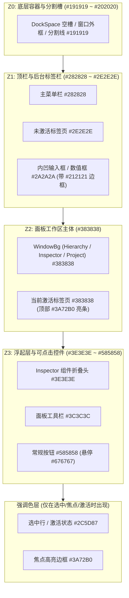

# TinyEditor 对齐 Unity 深色配色（Dark Theme）设计与实现计划

> **目标**：将 `TinyEditor` 当前使用的 Dear ImGui 原生默认深色样式（`ImGui::StyleColorsDark()`）整体升级为对齐 **Unity Editor Professional Dark Theme（Unity 2020 LTS ~ Unity 6）** 的深色视觉体系。通过在底层 `TinyImGui` 库中建立集中式的 `ImTheme`（或 `ImStyle`）主题与语义色板模块，统一全局 `ImGuiCol_` 颜色、控件几何度量（圆角/边框/内边距）、各面板细节质感、全局染色（Tint，供 Play Mode 使用），并支持在 `TinyEditor` 的 `Preferences` 中配置与持久化（同时 `TinyLauncher` 也可直接复用该主题）。
>
> 本文档为施工蓝图，代码片段均以「建议实现」形式给出并标注现有代码参考位置，不代表已落地。

---

## 1. 背景与现状诊断

### 1.1 当前实现现状

`TinyEditor` 基于 C++17 + Dear ImGui（开启 `DockingEnable` 与 `ViewportsEnable`）构建，其窗口布局（Hierarchy、Scene、Game、Inspector、Project、Console）与交互逻辑已经高度对齐 Unity，但在视觉呈现上仍停留在 ImGui 原生默认状态：

| 模块 / 文件 | 现状与位置 | 视觉差距与问题 |
|------------|-----------|---------------|
| **全局样式初始化** | [`EditorApp.cpp:534`](../../source/Editor/TinyEditor/EditorApp.cpp) 直接调用 `ImGui::StyleColorsDark()` | ImGui 原生深色主题为「纯黑底 `(0.06, 0.06, 0.06)` + 高饱和亮蓝表单 `(0.16, 0.29, 0.48)`」，对比度过强、蓝色刺眼，缺乏工业级编辑器的中性碳灰层级感 |
| **控件边框与圆角** | `ImGuiStyle` 保持默认：`FrameBorderSize = 0.0f`、`FrameRounding = 0.0f` | 输入框、下拉框、按钮没有外边框，完全靠色块区分，缺少 Unity 标志性的「深灰内凹输入框 + 1px 暗色细边框 + 2px 微圆角」质感 |
| **搜索框控件** | [`ImSearchInputText.cpp:102-157`](../../source/Editor/TinyEditor/GUIExtension/ImSearchInputText.cpp) 手绘矩形与外框 | `borderThickness = 2.0f`、`rounding = 5.0f`，背景直接取 `ImGuiCol_FrameBg`，悬停/激活全部用同一个颜色畫粗框，显得粗糙 |
| **Inspector 面板** | [`UIInspectorWindow.cpp:219, 240`](../../source/Editor/TinyEditor/UIInspectorWindow.cpp) 及 [`ImPropertyDrawer.cpp:255`](../../source/Editor/TinyEditor/GUIExtension/ImPropertyDrawer.cpp) | Prefab 文本蓝色 `(0.35, 0.55, 1.0)`、坐标轴 `kAxisColors` 等散落硬编码；组件 `CollapsingHeader` 使用 ImGui 蓝色半透明底，与 Unity 浅灰组件头 + 1px 顶底分割线风格不符 |
| **Hierarchy 面板** | [`UIHierarchyWindow.cpp:41`](../../source/Editor/TinyEditor/UIHierarchyWindow.cpp) 及 [`ImTreeWidget.cpp:358`](../../source/Editor/TinyImGui/Source/ImTreeWidget.cpp) | `kPrefabTextColor` 独立硬编码；树节点选中态无论窗口是否聚焦均为同一种高亮色，未区分聚焦选中（Unity 蓝 `#2C5D87`）与失焦选中（中性灰 `#4D4D4D`） |
| **Project 面板** | [`UIProjectWindow.cpp:945, 963`](../../source/Editor/TinyEditor/UIProjectWindow.cpp) | `UIAssetPathBar` 借用 `ImGuiCol_MenuBarBg` 充当路径栏背景色，职责耦合 |
| **分栏分割器** | [`ImSplitView.cpp:130`](../../source/Editor/TinyImGui/Source/ImSplitView.cpp) | `doLayout` 将 `ImGuiCol_Separator` 强行压入 `ImGuiCol_ChildBg`（默认全透明），导致左右分栏的分割线不可见且无拖拽视觉反馈 |
| **Play Mode 状态** | [`PlayModeController.cpp`](../../source/Editor/TinyEditor/PlayModeController.cpp) / [`UIGameWindow.cpp`](../../source/Editor/TinyEditor/UIGameWindow.cpp) | 进入 Play 模式后仅工具栏按钮变色，缺少 Unity 经典的 **Playmode Tint（播放态界面整体变暗/染色）**，容易在播放态下误改场景而不知情 |
| **偏好设置** | [`EditorSettings.h`](../../source/Editor/TinyEditor/EditorSettings.h) / [`UIPreferencesWindow.cpp`](../../source/Editor/TinyEditor/UIPreferencesWindow.cpp) | 目前仅有 `External Tools` 分类，尚无主题切换或颜色偏好配置项 |

### 1.2 本期目标

1. **在 `TinyImGui` 层建立集中式主题系统 `ImTheme`**：收拢所有 ImGui 基础色、几何度量参数与扩展语义色（`ImSemanticPalette`），让 `TinyImGui` 自身控件（`ImTreeWidget`、`ImSplitView`、`ImToolBar`、`ImDialog`）与上层 `TinyEditor` / `TinyLauncher` 共享同一套色板，消除散落的硬编码 `ImVec4`。
2. **1:1 还原 Unity Dark Theme 色彩层级**：精准对齐 Unity 的四级灰阶背景（底层暗槽 `#191919` → 标题/标签栏 `#282828` → 面板主体 `#383838` → 凸起按钮 `#585858` & 内凹输入框 `#2A2A2A`）与经典选中蓝 `#2C5D87`。
3. **精修核心面板与自定义控件**：升级 `ImSearchInputText`、`UIInspectorWindow` 组件头、`ImTreeWidget` 聚焦/失焦选中态、`ImSplitView` 分割线以及各面板顶栏 Toolbar。
4. **实现 Playmode Tint（播放态染色）**：进入 Play 模式时自动对全局 UI 施加可配置的乘算染色，退出 Play 时无损恢复。
5. **接入 `Preferences` 持久化**：在 `EditorSettings` 中持久化主题与 Playmode Tint 设置，并在 `UIPreferencesWindow` 中提供可视化配置页。

---

## 2. Unity Dark Theme 视觉规范与色板设计

### 2.1 核心灰阶与视觉层级原理

Unity 深色主题之所以耐看、层次分明，核心在于**用明暗度（Luminance）表达 UI 元素的 Z 轴深度与交互属性**，而非像 ImGui 默认主题那样到处使用彩色背景：



### 2.2 `ImGuiCol_` 全量色彩映射表（Unity Dark）

以下色值采集自 Unity Editor Dark Theme 标准色板，并提供可直接写入 `ImGuiStyle::Colors` 的归一化 RGBA 浮点值：

#### （1）文本与基础背景
| `ImGuiCol_` 枚举 | 角色说明 | Hex 色值 | `ImVec4 (R, G, B, A)` | 设计说明 |
|-----------------|---------|---------|-----------------------|---------|
| `ImGuiCol_Text` | 主文本 | `#D2D2D2` | `(0.824f, 0.824f, 0.824f, 1.00f)` | 柔和灰白，长时间注视不刺眼 |
| `ImGuiCol_TextDisabled` | 禁用/次要文本 | `#7F7F7F` | `(0.498f, 0.498f, 0.498f, 1.00f)` | 只读属性、占位提示文案 |
| `ImGuiCol_WindowBg` | 面板主背景 | `#383838` | `(0.220f, 0.220f, 0.220f, 1.00f)` | Unity 标志性面板中灰底色 |
| `ImGuiCol_ChildBg` | 子视图背景 | `#00000000` | `(0.000f, 0.000f, 0.000f, 0.00f)` | 默认透明，继承父窗口 `#383838` |
| `ImGuiCol_PopupBg` | 弹出菜单/下拉框 | `#303030` | `(0.188f, 0.188f, 0.188f, 0.98f)` | 略深于主面板，配合暗色外框突出浮层 |
| `ImGuiCol_DockingEmptyBg` | 停靠区空背景 | `#202020` | `(0.125f, 0.125f, 0.125f, 1.00f)` | 中心或空置 Dock 区域的深色底槽 |

#### （2）边框与分割线
| `ImGuiCol_` 枚举 | 角色说明 | Hex 色值 | `ImVec4 (R, G, B, A)` | 设计说明 |
|-----------------|---------|---------|-----------------------|---------|
| `ImGuiCol_Border` | 窗口/控件外边框 | `#232323` | `(0.137f, 0.137f, 0.137f, 1.00f)` | 勾勒输入框内凹感与按钮轮廓的关键 |
| `ImGuiCol_BorderShadow` | 边框阴影 | `#00000000` | `(0.000f, 0.000f, 0.000f, 0.00f)` | 扁平化设计，关闭阴影 |
| `ImGuiCol_Separator` | 常规分割线 | `#262626` | `(0.149f, 0.149f, 0.149f, 1.00f)` | Inspector 组件间、菜单项间的 1px 暗线 |
| `ImGuiCol_SeparatorHovered` | 分割线悬停 | `#3A72B0` | `(0.227f, 0.447f, 0.690f, 0.78f)` | 拖拽分栏时的悬停反馈 |
| `ImGuiCol_SeparatorActive` | 分割线拖拽中 | `#3A72B0` | `(0.227f, 0.447f, 0.690f, 1.00f)` | 拖拽分栏时的激活高亮 |

#### （3）标题栏、菜单栏与标签页（Docking Tabs）
| `ImGuiCol_` 枚举 | 角色说明 | Hex 色值 | `ImVec4 (R, G, B, A)` | 设计说明 |
|-----------------|---------|---------|-----------------------|---------|
| `ImGuiCol_TitleBg` | 窗口标题栏（失焦） | `#282828` | `(0.157f, 0.157f, 0.157f, 1.00f)` | 容纳 Dock 标签的深色轨道背景 |
| `ImGuiCol_TitleBgActive` | 窗口标题栏（聚焦） | `#282828` | `(0.157f, 0.157f, 0.157f, 1.00f)` | 与失焦保持一致，靠 TabActive 区分聚焦 |
| `ImGuiCol_TitleBgCollapsed` | 折叠标题栏 | `#282828` | `(0.157f, 0.157f, 0.157f, 0.75f)` | |
| `ImGuiCol_MenuBarBg` | 顶部主菜单栏 | `#282828` | `(0.157f, 0.157f, 0.157f, 1.00f)` | File / Edit / Assets 所在顶栏 |
| `ImGuiCol_Tab` | 未选中标签页 | `#2E2E2E` | `(0.180f, 0.180f, 0.180f, 1.00f)` | 比轨道 `#282828` 略亮，比面板 `#383838` 暗 |
| `ImGuiCol_TabHovered` | 标签页悬停 | `#3E3E3E` | `(0.243f, 0.243f, 0.243f, 1.00f)` | |
| `ImGuiCol_TabActive` | 当前激活标签页 | `#383838` | `(0.220f, 0.220f, 0.220f, 1.00f)` | 与 `WindowBg` 同色，实现标签与面板无缝衔接 |
| `ImGuiCol_TabUnfocused` | 失焦窗口未选中标签 | `#282828` | `(0.157f, 0.157f, 0.157f, 1.00f)` | |
| `ImGuiCol_TabUnfocusedActive` | 失焦窗口当前标签 | `#383838` | `(0.220f, 0.220f, 0.220f, 1.00f)` | 保持与面板同色，不因失焦而突兀变暗 |

#### （4）表单输入框、按钮、滑块与复选框
| `ImGuiCol_` 枚举 | 角色说明 | Hex 色值 | `ImVec4 (R, G, B, A)` | 设计说明 |
|-----------------|---------|---------|-----------------------|---------|
| `ImGuiCol_FrameBg` | 输入框/复选框底色 | `#2A2A2A` | `(0.165f, 0.165f, 0.165f, 1.00f)` | 比 `#383838` 面板深，形成内凹槽感 |
| `ImGuiCol_FrameBgHovered` | 输入框悬停 | `#303030` | `(0.188f, 0.188f, 0.188f, 1.00f)` | 悬停微亮 |
| `ImGuiCol_FrameBgActive` | 输入框激活/输入中 | `#222222` | `(0.133f, 0.133f, 0.133f, 1.00f)` | 激活时底色更深沉 |
| `ImGuiCol_Button` | 按钮常态 | `#585858` | `(0.345f, 0.345f, 0.345f, 1.00f)` | 比 `#383838` 面板亮，形成凸起可按感 |
| `ImGuiCol_ButtonHovered` | 按钮悬停 | `#676767` | `(0.404f, 0.404f, 0.404f, 1.00f)` | |
| `ImGuiCol_ButtonActive` | 按钮按下 / Toggle 激活 | `#46607C` | `(0.275f, 0.376f, 0.486f, 1.00f)` | Unity 工具栏 Toggle（如 Play 按钮）按下蓝 |
| `ImGuiCol_CheckMark` | 复选框勾号 | `#CCCCCC` | `(0.800f, 0.800f, 0.800f, 1.00f)` | 清晰灰白勾号 |
| `ImGuiCol_SliderGrab` | 滑块把手常态 | `#787878` | `(0.471f, 0.471f, 0.471f, 1.00f)` | |
| `ImGuiCol_SliderGrabActive` | 滑块把手拖拽中 | `#3A79BB` | `(0.227f, 0.475f, 0.733f, 1.00f)` | 拖拽时亮蓝反馈 |

#### （5）列表选中、折叠头、表格与滚动条
| `ImGuiCol_` 枚举 | 角色说明 | Hex 色值 | `ImVec4 (R, G, B, A)` | 设计说明 |
|-----------------|---------|---------|-----------------------|---------|
| `ImGuiCol_Header` | 折叠头 / 选中行常态 | `#2C5D87` | `(0.173f, 0.365f, 0.529f, 1.00f)` | Unity 经典列表/树节点选中蓝 |
| `ImGuiCol_HeaderHovered` | 折叠头 / 列表项悬停 | `#444444` | `(0.267f, 0.267f, 0.267f, 1.00f)` | 悬停行采用中性浅灰，不抢选中态视觉 |
| `ImGuiCol_HeaderActive` | 折叠头 / 列表项点击瞬间 | `#3A72B0` | `(0.227f, 0.447f, 0.690f, 1.00f)` | |
| `ImGuiCol_ScrollbarBg` | 滚动条轨道 | `#282828` | `(0.157f, 0.157f, 0.157f, 0.60f)` | |
| `ImGuiCol_ScrollbarGrab` | 滚动条滑块 | `#555555` | `(0.333f, 0.333f, 0.333f, 1.00f)` | |
| `ImGuiCol_ScrollbarGrabHovered` | 滚动条滑块悬停 | `#686868` | `(0.408f, 0.408f, 0.408f, 1.00f)` | |
| `ImGuiCol_ScrollbarGrabActive` | 滚动条滑块拖拽 | `#7D7D7D` | `(0.490f, 0.490f, 0.490f, 1.00f)` | |
| `ImGuiCol_TableHeaderBg` | 表头背景 | `#2E2E2E` | `(0.180f, 0.180f, 0.180f, 1.00f)` | |
| `ImGuiCol_TableBorderStrong` | 表格外框线 | `#232323` | `(0.137f, 0.137f, 0.137f, 1.00f)` | |
| `ImGuiCol_TableBorderLight` | 表格内部分割线 | `#2C2C2C` | `(0.173f, 0.173f, 0.173f, 1.00f)` | |
| `ImGuiCol_TableRowBg` | 表格偶数行 | `#00000000` | `(0.000f, 0.000f, 0.000f, 0.00f)` | |
| `ImGuiCol_TableRowBgAlt` | 表格奇数行（斑马纹） | `#FFFFFF08` | `(1.000f, 1.000f, 1.000f, 0.03f)` | 极轻微交替行底色 |

#### （6）辅助交互色（拖拽、选区、模态遮罩）
| `ImGuiCol_` 枚举 | 角色说明 | Hex 色值 | `ImVec4 (R, G, B, A)` | 设计说明 |
|-----------------|---------|---------|-----------------------|---------|
| `ImGuiCol_TextSelectedBg` | 文本框选区高亮 | `#2C5D87A6` | `(0.173f, 0.365f, 0.529f, 0.65f)` | |
| `ImGuiCol_DragDropTarget` | 资产/对象拖拽目标框 | `#3A79BBE6` | `(0.227f, 0.475f, 0.733f, 0.90f)` | 替代 ImGui 刺眼的纯黄 `#FFFF00` |
| `ImGuiCol_DockingPreview` | 窗口停靠预览区 | `#2C5D87B3` | `(0.173f, 0.365f, 0.529f, 0.70f)` | |
| `ImGuiCol_NavHighlight` | 键盘焦点导航框 | `#3A72B0` | `(0.227f, 0.447f, 0.690f, 1.00f)` | |
| `ImGuiCol_ResizeGrip` | 窗口右下角缩放柄 | `#FFFFFF1A` | `(1.000f, 1.000f, 1.000f, 0.10f)` | |
| `ImGuiCol_ResizeGripHovered` | 缩放柄悬停 | `#3A72B0AB` | `(0.227f, 0.447f, 0.690f, 0.67f)` | |
| `ImGuiCol_ResizeGripActive` | 缩放柄拖拽 | `#3A72B0F2` | `(0.227f, 0.447f, 0.690f, 0.95f)` | |
| `ImGuiCol_ModalWindowDimBg` | 模态弹窗背景遮罩 | `#00000073` | `(0.000f, 0.000f, 0.000f, 0.45f)` | 替代原亮灰遮罩，改用纯黑半透明压暗背景 |

### 2.3 `ImGuiStyle` 几何与排版度量参数

为了让控件摆脱 ImGui 默认的「悬浮宽松感」，呈现 Unity 紧凑、锐利的工业软件风格，需同步调整 `ImGuiStyle` 的几何参数：

| `ImGuiStyle` 字段 | ImGui 默认值 | Unity Dark 设定值 | 作用说明 |
|------------------|-------------|------------------|---------|
| `WindowPadding` | `(8, 8)` | `ImVec2(6.0f, 6.0f)` | 面板四周留白更紧凑 |
| `FramePadding` | `(4, 3)` | `ImVec2(5.0f, 3.0f)` | 输入框与按钮内部留白适中 |
| `ItemSpacing` | `(8, 4)` | `ImVec2(6.0f, 4.0f)` | 属性行间距紧凑且不拥挤 |
| `ItemInnerSpacing` | `(4, 4)` | `ImVec2(4.0f, 4.0f)` | 组合控件内部间距 |
| `CellPadding` | `(4, 2)` | `ImVec2(4.0f, 2.0f)` | 表格单元格内边距 |
| `IndentSpacing` | `21.0f` | `14.0f` | Hierarchy / 资产树层级缩进（21px 过宽，14px 贴近 Unity） |
| `ScrollbarSize` | `14.0f` | `12.0f` | 更纤细的滚动条 |
| `GrabMinSize` | `12.0f` | `10.0f` | 滑块最小宽度 |
| `WindowBorderSize` | `1.0f` | `1.0f` | 窗口 1px 暗色边框 |
| `ChildBorderSize` | `1.0f` | `1.0f` | 子视图边框 |
| `PopupBorderSize` | `1.0f` | `1.0f` | 菜单/弹窗 1px 暗色边框 |
| `FrameBorderSize` | `0.0f` | **`1.0f`** | **核心改动**：开启输入框/按钮的 1px `#232323` 外框 |
| `TabBorderSize` | `0.0f` | `0.0f` | 标签页无外框 |
| `TabBarBorderSize` | `1.0f` | `1.0f` | 标签栏底部 1px 分界线 |
| `DockingSeparatorSize` | `2.0f` | `2.0f` | Dock 面板间 2px 黑色分割槽 |
| `WindowRounding` | `0.0f` | `0.0f` | 多视口模式下保持直角 |
| `ChildRounding` | `0.0f` | `0.0f` | 子视图保持直角 |
| `PopupRounding` | `0.0f` | `2.0f` | 弹出菜单微圆角 |
| `FrameRounding` | `0.0f` | **`2.0f`** | **核心改动**：输入框、按钮、Combo 统一 2px 微圆角 |
| `ScrollbarRounding` | `9.0f` | `6.0f` | 滚动条胶囊圆角 |
| `GrabRounding` | `0.0f` | `2.0f` | 滑块微圆角 |
| `TabRounding` | `4.0f` | `2.0f` | 面板标签页顶部 2px 微圆角 |

### 2.4 扩展语义色板（`ImSemanticPalette`）

针对 `ImGuiCol_` 未能直接覆盖的特色 UI 元素，在 `TinyImGui` 中定义专属语义色：

| 语义字段名 | Hex 色值 | `ImVec4` 值 | 适用场景 |
|-----------|---------|------------|---------|
| `toolbarBg` | `#3C3C3C` | `(0.235f, 0.235f, 0.235f, 1.00f)` | `ImToolBar` 及 Hierarchy / Project / Game / Scene 面板顶部工具栏底色 |
| `statusBarBg` | `#303030` | `(0.188f, 0.188f, 0.188f, 1.00f)` | Project 面板路径栏（`UIAssetPathBar`）与底部状态栏底色 |
| `sectionHeaderBg` | `#3E3E3E` | `(0.243f, 0.243f, 0.243f, 1.00f)` | Inspector 组件 `CollapsingHeader` 常态背景色（与列表选中色解耦！） |
| `sectionHeaderHovered` | `#474747` | `(0.278f, 0.278f, 0.278f, 1.00f)` | Inspector 组件头悬停背景色 |
| `sectionHeaderActive` | `#4E4E4E` | `(0.306f, 0.306f, 0.306f, 1.00f)` | Inspector 组件头按下背景色 |
| `selectionFocused` | `#2C5D87` | `(0.173f, 0.365f, 0.529f, 1.00f)` | `ImTreeWidget` / `ImListWidget` 节点在当前面板拥有焦点时的选中背景色 |
| `selectionUnfocused` | `#4D4D4D` | `(0.302f, 0.302f, 0.302f, 1.00f)` | `ImTreeWidget` / `ImListWidget` 节点在当前面板失去焦点时的选中背景色 |
| `searchBoxBg` | `#252525` | `(0.145f, 0.145f, 0.145f, 1.00f)` | `ImSearchInputText` 搜索框内凹背景 |
| `searchBoxBorder` | `#1C1C1C` | `(0.110f, 0.110f, 0.110f, 1.00f)` | `ImSearchInputText` 常态 1px 边框 |
| `searchBoxBorderFocused` | `#3A72B0` | `(0.227f, 0.447f, 0.690f, 1.00f)` | `ImSearchInputText` 聚焦/输入时 1px 亮蓝边框 |
| `prefabText` | `#7DA7FF` | `(0.490f, 0.655f, 1.000f, 1.00f)` | Hierarchy 树与 Inspector 中的 Prefab 实例文字颜色 |
| `axisX` / `axisY` / `axisZ` / `axisW` | `#E84F4F` / `#78CC45` / `#598CF2` / `#BFBFBF` | 见代码草案 | `ImPropertyDrawer` 中 Vector / Euler 分量标签色 |
| `logInfo` / `logWarning` / `logError` | `#D2D2D2` / `#F5B727` / `#E85454` | 见代码草案 | Console 面板与 `ImMessageBox` 提示文本色 |
| `globalTint` | `#CCCCCC` | `(0.800f, 0.800f, 0.800f, 1.00f)` | 全局色彩乘算因子（供 Play Mode 染色使用，默认整体压暗 20%，可在 Preferences 修改） |

---

## 3. 总体架构与核心模块设计

### 3.1 模块归属：下沉至 `TinyImGui`

将主题与样式管理下沉到 `source/Editor/TinyImGui`（命名遵循 `TinyImGui` 的 `Im*` 前缀规范，定为 **`ImTheme`**），具备以下架构优势：
1. **单向依赖自然闭环**：`TinyImGui` 是底层 UI 控件库，`TinyEditor` 和 `TinyLauncher` 均依赖 `TinyImGui`。将 `ImTheme` 放在 `TinyImGui` 中，`ImTreeWidget`（聚焦/失焦选中色）、`ImToolBar`（工具栏背景色）、`ImSplitView`（分割线）、`ImMessageBox`（警告文本色）可以直接访问 `ImTheme::getPalette()`，无需任何跨模块回调或接口注入。
2. **多端直接复用**：`TinyLauncher`（启动器）同样使用 `TinyImGui`，只需把 `LauncherApp.cpp:324` 的 `ImGui::StyleColorsDark()` 替换为 `ImTheme::applyTheme()`，即可零成本同步为 Unity Hub / Unity Dark 风格。

```mermaid
flowchart LR
    subgraph TinyEditor ["TinyEditor / TinyLauncher (上层应用)"]
        Settings["EditorSettings\n(themeId / playModeTint)"]
        Prefs["UIPreferencesWindow\n(Theme & Colors 页)"]
        PlayCtrl["PlayModeController\n(doPlay / doStop)"]
        EditorWnds["Editor 窗口与扩展控件\n(Inspector / Hierarchy / Project / SearchBox)"]
    end

    subgraph TinyImGui ["TinyImGui (底层 UI 库)"]
        Theme["ImTheme (TINYIMGUI_API)\n主题与语义色板管理"]
        ImWidgets["TinyImGui 基础控件\n(ImTreeWidget / ImToolBar / ImSplitView / ImDialog)"]
    end

    Settings -->|启动加载| Theme
    Prefs -->|实时修改 & 保存| Theme
    Prefs --> Settings
    PlayCtrl -->|setTintActive| Theme
    Theme -->|写入 Colors & Metrics| ImGui["ImGui::GetStyle()"]
    Theme -->|getPalette()| ImWidgets
    Theme -->|getPalette()| EditorWnds
```

### 3.2 新增核心类：`ImTheme`（位于 `TinyImGui`）

在 `source/Editor/TinyImGui/Include/ImTheme.h` 与 `source/Editor/TinyImGui/Source/ImTheme.cpp` 中新增 `ImTheme`（并在 `TinyImGui.h` 中导出）：

```cpp
// source/Editor/TinyImGui/Include/ImTheme.h
#pragma once

#include "ImPrerequisites.h"

namespace Tiny3D
{
    /// 主题枚举（预留浅色与经典主题扩展）
    enum class ImThemeId : int32_t
    {
        kUnityDark = 0,         ///< Unity Professional 深色主题（默认）
        kUnityLight = 1,        ///< Unity Personal 浅色主题（预留）
        kImGuiDark = 2          ///< ImGui 原生深色主题（回退/对比用）
    };

    /// 扩展语义色板
    struct ImSemanticPalette
    {
        ImVec4 toolbarBg;
        ImVec4 statusBarBg;
        ImVec4 sectionHeaderBg;
        ImVec4 sectionHeaderHovered;
        ImVec4 sectionHeaderActive;
        ImVec4 selectionFocused;
        ImVec4 selectionUnfocused;
        ImVec4 searchBoxBg;
        ImVec4 searchBoxBorder;
        ImVec4 searchBoxBorderFocused;
        ImVec4 prefabText;
        ImVec4 axisColors[4];
        ImVec4 logInfo;
        ImVec4 logWarning;
        ImVec4 logError;
        ImVec4 globalTint;
    };

    /**
     * @brief 全局 ImGui 样式与主题管理器
     */
    class TINYIMGUI_API ImTheme
    {
    public:
        /// 初始化并应用指定主题（在 EditorApp / LauncherApp 的 createImGuiEnv 中调用）
        static void applyTheme(ImThemeId theme = ImThemeId::kUnityDark);

        /// 获取当前主题 ID
        static ImThemeId getCurrentTheme() { return msCurrentTheme; }

        /// 获取当前语义色板（若全局染色处于激活态，返回的 UI 背景/控件色已含染色）
        static const ImSemanticPalette &getPalette() { return msActivePalette; }

        /// 设置或更新全局染色乘算因子（例如 Playmode Tint）
        static void setGlobalTint(const ImVec4 &tint);
        static const ImVec4 &getGlobalTint() { return msBasePalette.globalTint; }

        /// 切换全局染色状态（由 PlayModeController::doPlay / doStop 调用）
        static void setTintActive(bool active);
        static bool isTintActive() { return msTintActive; }

    private:
        static void setupGeometryMetrics(ImGuiStyle &style);
        static void setupUnityDarkColors(ImVec4 *colors, ImSemanticPalette &palette);
        static void setupImGuiDarkColors(ImVec4 *colors, ImSemanticPalette &palette);
        static void refreshActiveColors();
        static ImVec4 multiplyColor(const ImVec4 &color, const ImVec4 &tint);

    private:
        static ImThemeId          msCurrentTheme;
        static bool               msTintActive;
        static ImVec4             msBaseColors[ImGuiCol_COUNT];
        static ImSemanticPalette  msBasePalette;
        static ImSemanticPalette  msActivePalette;
    };
}
```

### 3.3 关键设计细节

#### （1）为什么需要将 `sectionHeaderBg` 与 `ImGuiCol_Header` 解耦？
在 Dear ImGui 中，`ImGuiCol_Header` 被同时用于两个截然不同的场景：
1. `ImGui::TreeNodeEx`（带 `ImGuiTreeNodeFlags_Selected`）和 `ImGui::Selectable` 的**选中高亮背景**；
2. `ImGui::CollapsingHeader`（Inspector 组件折叠标题栏）的**常态背景**。

如果把 `ImGuiCol_Header` 设为 Unity 选中蓝 `#2C5D87`，那么 Hierarchy 选中的节点是正确的蓝色，但 Inspector 里**每一个组件的标题栏都会变成刺眼的蓝条**；反之，如果把 `ImGuiCol_Header` 设为组件头的浅灰色 `#3E3E3E`，那么 Hierarchy 选中节点又失去了蓝色高亮。

**解决方案**：
- 全局 `ImGuiCol_Header` 设为 Unity 选中蓝 `#2C5D87`，保证所有 `TreeNode`、`Selectable`、`MenuItem` 选中时呈现标准 Unity 蓝；
- 在 [`UIInspectorWindow::drawComponent`](../../source/Editor/TinyEditor/UIInspectorWindow.cpp) 绘制 `ImGui::CollapsingHeader` 前后，局部压入 `ImTheme::getPalette().sectionHeaderBg`（`#3E3E3E`）：
  ```cpp
  const auto &palette = ImTheme::getPalette();
  ImGui::PushStyleColor(ImGuiCol_Header, palette.sectionHeaderBg);
  ImGui::PushStyleColor(ImGuiCol_HeaderHovered, palette.sectionHeaderHovered);
  ImGui::PushStyleColor(ImGuiCol_HeaderActive, palette.sectionHeaderActive);
  const bool expanded = ImGui::CollapsingHeader(title.c_str(), ImGuiTreeNodeFlags_DefaultOpen);
  ImGui::PopStyleColor(3);
  ```
这样既保证了树/列表选中是 Unity 蓝，又保证了 Inspector 组件折叠头是沉稳的 `#3E3E3E` 浅灰条。

#### （2）Playmode Tint（播放态全局染色）实现机制
Unity 在进入 Play 模式时会将编辑器所有 UI 染色（默认乘算 `(0.8, 0.8, 0.8, 1.0)` 压暗，或由用户指定为紫红/青绿等明显颜色），但**不对 3D 视口（Scene / Game 渲染纹理）染色**。
- `ImTheme` 内部维护一份基准颜色表 `msBaseColors[ImGuiCol_COUNT]` 与 `msBasePalette`；
- 当 `ImTheme::setTintActive(true)` 被调用时，遍历 `msBaseColors`，对 RGB 分量乘以 `globalTint`（保持 Alpha 分量不变），写回 `ImGui::GetStyle().Colors` 与 `msActivePalette`；
- 因为 `UISceneWindow` 与 `UIGameView` 使用 `ImGui::Image(texID, size)` 绘制时的默认 `tint_col` 为 `(1, 1, 1, 1)`，不受 `ImGuiStyle::Colors` 影响，因此 **Scene 与 Game 的画面天然保持原色，而四周所有编辑器面板、工具栏、Inspector 自动完成染色**，与 Unity 行为完全一致。

---

## 4. 分阶段实施计划（Phased Plan）

### Phase 1：`TinyImGui` 主题模块 `ImTheme` 与全局色板落地

**目标**：在 `TinyImGui` 中新增 `ImTheme` 模块并在 `EditorApp::createImGuiEnv()`（及可选 `LauncherApp::createImGuiEnv()`）中接入，启动编辑器即可看到整体碳灰深色界面、1px 暗框内凹输入框与 2px 微圆角。

**涉及文件**：
- 新增 `source/Editor/TinyImGui/Include/ImTheme.h`
- 新增 `source/Editor/TinyImGui/Source/ImTheme.cpp`
- 修改 [`source/Editor/TinyImGui/Include/TinyImGui.h`](../../source/Editor/TinyImGui/Include/TinyImGui.h)（加入 `#include <ImTheme.h>`）
- 修改 [`source/Editor/TinyEditor/EditorApp.cpp`](../../source/Editor/TinyEditor/EditorApp.cpp)

**关键改动草案（`EditorApp::createImGuiEnv`）**：
```cpp
// EditorApp.cpp:533 附近
// Setup Dear ImGui style (Unity Professional Dark Theme)
ImTheme::applyTheme(ImThemeId::kUnityDark);

ImGuiStyle& style = ImGui::GetStyle();
style.WindowMenuButtonPosition = ImGuiDir_None;
```

**验收标准**：
1. 编译 `TinyImGui` 与 `TinyEditor` 通过并启动，面板背景变为 `#383838` 中性灰，菜单栏与标签轨道为 `#282828` 深灰。
2. 所有 `InputText`、`DragFloat`、`Combo` 呈现 `#2A2A2A` 内凹深灰底 + `#232323` 1px 细边框 + `2px` 圆角；按钮呈现 `#585858` 微凸灰底。

---

### Phase 2：`TinyImGui` 控件与 `TinyEditor` 面板视觉精修

**目标**：消除散落的硬编码颜色，修复自定义控件的边框、组件头样式、工具栏背景与分栏分割线。

**涉及文件与具体改造点**：

1. **`UIInspectorWindow.cpp` & `ImPropertyDrawer.cpp`（Inspector 面板精修）**
   - 在 `UIInspectorWindow::drawComponent` 中：
     - 每个组件前使用 `ImGui::Separator()` 绘制贯穿分割线；
     - 为 `ImGui::CollapsingHeader` 局部 `PushStyleColor` 应用 `palette.sectionHeaderBg / Hovered / Active`；
   - 将 `UIInspectorWindow.cpp:219, 240` 的硬编码 Prefab 颜色替换为 `ImTheme::getPalette().prefabText`；
   - 将 `ImPropertyDrawer.cpp:255` 的 `kAxisColors` 替换为 `ImTheme::getPalette().axisColors`。

2. **`ImSearchInputText.cpp`（搜索框精修）**
   - 将 `borderThickness` 从 `2.0f` 改为 `1.0f`，外框圆角设为 `3.0f`（或胶囊圆角 `inputSize.y * 0.5f`）；
   - 背景色改用 `palette.searchBoxBg`（`#252525`），常态外框改用 `palette.searchBoxBorder`（`#1C1C1C`），聚焦/激活外框改用 `palette.searchBoxBorderFocused`（`#3A72B0`）；
   - 移除原本鼠标仅悬停（`IsItemHovered()`）就触发亮蓝框的逻辑，改为仅在 `IsItemFocused() || IsItemActive()` 时显示亮蓝焦点框（与 Unity 搜索框行为一致）。

3. **`ImTreeWidget.cpp` & `UIHierarchyWindow.cpp`（层级树与选中态精修）**
   - `UIHierarchyWindow.cpp:41` 的 `kPrefabTextColor` 改用 `ImTheme::getPalette().prefabText`；
   - 在 `TinyImGui` 的 `ImTreeNode::onGUIBegin` 中直接读取 `ImTheme::getPalette()`：当节点处于选中状态且当前窗口未聚焦（`!ImGui::IsWindowFocused(ImGuiFocusedFlags_RootAndChildWindows)`）时，局部压入 `ImGuiCol_Header = palette.selectionUnfocused`（`#4D4D4D`），实现**聚焦时蓝、失焦时灰**的 Unity 经典多面板焦点反馈。

4. **`ImSplitView.cpp` & `UIProjectWindow.cpp`（Project 面板与分栏线修复）**
   - `UIAssetPathBar::onGUIBegin`（`UIProjectWindow.cpp:945, 963`）中将 `style.Colors[ImGuiCol_MenuBarBg]` 替换为 `ImTheme::getPalette().statusBarBg`；
   - `ImSplitView::doLayout`（`ImSplitView.cpp:130`）中移除 `ImGui::PushStyleColor(ImGuiCol_Separator, ImGui::GetStyleColorVec4(ImGuiCol_ChildBg))`，让 `SplitterBehavior` 正常绘制 `ImGuiCol_Separator`（`#262626`）分割线，并在悬停拖拽时显示蓝色高亮。

5. **面板顶部工具栏底色统一（`ImToolBar` / `UIHierarchyToolBar` / `UIProjectToolBar`）**
   - 在 `ImToolBar::onGUIBegin` / `onGUIEnd`（以及继承自 `ImChildView` 的 `UIHierarchyToolBar` / `UIProjectToolBar`）中直接压入 `ImGuiCol_ChildBg = ImTheme::getPalette().toolbarBg`（`#3C3C3C`），并在底部保留 `ImGui::Separator()`，形成与面板主体 `#383838` 区分开的顶栏条。

**验收标准**：
1. Inspector 中组件折叠头为 `#3E3E3E` 灰色，而 Hierarchy 与 Project 树选中项为 `#2C5D87` 蓝色；切换焦点到其他面板时，原面板选中项变为 `#4D4D4D` 灰色。
2. Hierarchy 和 Project 的搜索框呈现 1px 细边框，点击输入时变为 `#3A72B0` 亮蓝边框。
3. Project 面板左右分栏之间有清晰的 1px 暗色分割线，鼠标悬停可感知拖拽区域。

---

### Phase 3：Play Mode 全局染色（Playmode Tint）联动

**目标**：进入 Play 态时自动对编辑器 UI 进行乘算染色，退出 Play 态时恢复原色。

**涉及文件**：
- [`source/Editor/TinyEditor/PlayModeController.cpp`](../../source/Editor/TinyEditor/PlayModeController.cpp)
- `source/Editor/TinyImGui/Source/ImTheme.cpp`

**关键改动草案**：
- 在 `PlayModeController::doPlay()` 中调用 `T3D_AGENT.enterPlayMode()` 之后，补充：
  ```cpp
  ImTheme::setTintActive(true);
  ```
- 在 `PlayModeController::doStop()` 与 `PlayModeController::onProjectClosing()` 中调用 `T3D_AGENT.exitPlayMode()` 之后，补充：
  ```cpp
  ImTheme::setTintActive(false);
  ```

**验收标准**：
1. 点击 Game 窗口的 Play 按钮进入播放模式，整个编辑器 UI（菜单栏、工具栏、Hierarchy、Inspector、Project）立即按 `globalTint` 变暗/染色，而 Game / Scene 视口画面颜色不受影响。
2. 再次点击 Play 按钮停止播放，编辑器 UI 立即恢复正常的 Unity Dark 色调。

---

### Phase 4：Preferences 偏好设置接入与持久化

**目标**：允许用户在 `Edit -> Preferences...` 中切换编辑器主题（Unity Dark / ImGui Dark）及自定义 `Playmode Tint` 颜色，并随 `EditorSettings` 自动序列化落盘。

**涉及文件**：
- [`source/Editor/TinyEditor/EditorSettings.h`](../../source/Editor/TinyEditor/EditorSettings.h)
- [`source/Editor/TinyEditor/EditorApp.cpp`](../../source/Editor/TinyEditor/EditorApp.cpp)
- [`source/Editor/TinyEditor/UIPreferencesWindow.h`](../../source/Editor/TinyEditor/UIPreferencesWindow.h)
- [`source/Editor/TinyEditor/UIPreferencesWindow.cpp`](../../source/Editor/TinyEditor/UIPreferencesWindow.cpp)
- 语言表文件：`Editor/Language/lang-en-us.txt`、`Editor/Language/lang-zh-hans.txt` 及 `Language.h`（配合 `ESTR` 回退机制）

**关键改动草案（`EditorSettings.h`）**：
```cpp
TSTRUCT()
struct EditorSettings
{
    /// 打开 .sln 的 IDE 可执行文件；空表示走系统文件关联
    TPROPERTY()
    String externalEditorPath {};

    /// 下拉框显示名，如 "Visual Studio 2022"
    TPROPERTY()
    String externalEditorName {};

    /// 编辑器主题（0: Unity Dark, 2: ImGui Classic Dark）
    TPROPERTY()
    int32_t themeId {0};

    /// Play 模式下的 UI 染色乘算因子
    TPROPERTY()
    ColorRGBA playModeTint {0.80f, 0.80f, 0.80f, 1.00f};
};
```

**`UIPreferencesWindow` 扩展**：
- 在左侧 `##PrefsCategories` 列表增加 `General`（或 `Colors`）分类项；
- 右侧绘制：
  - `Editor Theme` 下拉框（`Unity Dark` / `ImGui Dark`），切换时立即调用 `ImTheme::applyTheme(...)` 并 `saveEditorSettings()`；
  - `Playmode Tint` 颜色拾取器（`ImGui::ColorEdit4`）与 `Reset` 按钮，修改时实时调用 `ImTheme::setGlobalTint(...)`（若当前正处于 Play 模式，可实时看到染色变化）并保存设置。

**验收标准**：
1. 打开 `Edit -> Preferences...`，可在 `General / Colors` 页切换主题、调整 `Playmode Tint` 颜色并实时生效。
2. 关闭并重启 `TinyEditor`，上次保存的主题与 `Playmode Tint` 配置自动恢复。

---

## 5. 涉及文件汇总清单

### 新增文件
| 文件路径 | 职责说明 | 所属阶段 |
|---------|---------|---------|
| `source/Editor/TinyImGui/Include/ImTheme.h` | `ImTheme` 类（带 `TINYIMGUI_API` 导出）、`ImThemeId` 枚举、`ImSemanticPalette` 结构体声明 | Phase 1 |
| `source/Editor/TinyImGui/Source/ImTheme.cpp` | Unity Dark 颜色表、几何度量参数、全局 Tint 染色算法实现 | Phase 1, 3 |

### 修改文件
| 文件路径 | 改动内容摘要 | 所属阶段 |
|---------|------------|---------|
| [`source/Editor/TinyImGui/Include/TinyImGui.h`](../../source/Editor/TinyImGui/Include/TinyImGui.h) | 导出 `#include <ImTheme.h>` | Phase 1 |
| [`source/Editor/TinyEditor/EditorApp.cpp`](../../source/Editor/TinyEditor/EditorApp.cpp) | `createImGuiEnv()` 中用 `ImTheme::applyTheme` 替换 `ImGui::StyleColorsDark()`，并应用 `mEditorSettings` 中的主题与染色配置 | Phase 1, 4 |
| [`source/Editor/TinyEditor/UIInspectorWindow.cpp`](../../source/Editor/TinyEditor/UIInspectorWindow.cpp) | 组件 `CollapsingHeader` 应用 `sectionHeaderBg` 样式色；Prefab 文本颜色改读 `ImTheme::getPalette()` | Phase 2 |
| [`source/Editor/TinyEditor/GUIExtension/ImPropertyDrawer.cpp`](../../source/Editor/TinyEditor/GUIExtension/ImPropertyDrawer.cpp) | `kAxisColors` 改读 `ImTheme::getPalette().axisColors` | Phase 2 |
| [`source/Editor/TinyEditor/GUIExtension/ImSearchInputText.cpp`](../../source/Editor/TinyEditor/GUIExtension/ImSearchInputText.cpp) | 搜索框改为 1px 边框 + 3px 圆角，接入 `searchBoxBg / Border / BorderFocused` 语义色 | Phase 2 |
| [`source/Editor/TinyEditor/UIHierarchyWindow.cpp`](../../source/Editor/TinyEditor/UIHierarchyWindow.cpp) | `kPrefabTextColor` 改读 `ImTheme::getPalette().prefabText`；工具栏接入 `toolbarBg` | Phase 2 |
| [`source/Editor/TinyImGui/Source/ImTreeWidget.cpp`](../../source/Editor/TinyImGui/Source/ImTreeWidget.cpp) | 直接读取 `ImTheme::getPalette()`，区分窗口聚焦/失焦时的选中节点高亮背景色 | Phase 2 |
| [`source/Editor/TinyImGui/Source/ImToolBar.cpp`](../../source/Editor/TinyImGui/Source/ImToolBar.cpp) | 直接读取 `ImTheme::getPalette().toolbarBg` 设置工具栏底色 | Phase 2 |
| [`source/Editor/TinyEditor/UIProjectWindow.cpp`](../../source/Editor/TinyEditor/UIProjectWindow.cpp) | `UIAssetPathBar` 改用 `statusBarBg`；工具栏接入 `toolbarBg` | Phase 2 |
| [`source/Editor/TinyImGui/Source/ImSplitView.cpp`](../../source/Editor/TinyImGui/Source/ImSplitView.cpp) | 移除将 `ImGuiCol_Separator` 覆盖为透明 `ChildBg` 的逻辑，恢复 1px 分栏暗线 | Phase 2 |
| [`source/Editor/TinyEditor/PlayModeController.cpp`](../../source/Editor/TinyEditor/PlayModeController.cpp) | `doPlay()` / `doStop()` / `onProjectClosing()` 中联动 `ImTheme::setTintActive()` | Phase 3 |
| [`source/Editor/TinyEditor/EditorSettings.h`](../../source/Editor/TinyEditor/EditorSettings.h) | 新增 `themeId` 与 `playModeTint` 反射属性 | Phase 4 |
| [`source/Editor/TinyEditor/UIPreferencesWindow.h/.cpp`](../../source/Editor/TinyEditor/UIPreferencesWindow.cpp) | 新增 `General / Colors` 偏好设置页，支持主题切换与 Playmode Tint 编辑 | Phase 4 |

---

## 6. 风险与注意事项

1. **`PushStyleColor` / `PopStyleColor` 严格配对**：
   - 在 `UIInspectorWindow`、`UIAssetPathBar`、`ImTreeNode`、`ImToolBar` 等处局部压栈颜色时，必须确保无论 `Begin` / `TreeNodeEx` 返回 `true` 还是 `false`，`PopStyleColor` 都会在相同层级被对称执行，防止 ImGui 样式栈泄漏导致断言崩溃。
2. **多视口（Multi-Viewport）下的 `WindowBg` Alpha 值**：
   - `TinyEditor` 开启了 `ImGuiConfigFlags_ViewportsEnable`。当面板被拖出主窗口成为独立 OS 窗口时，要求 `style.Colors[ImGuiCol_WindowBg].w = 1.0f` 且 `style.WindowRounding = 0.0f`（见 [`EditorApp.cpp:539-543`](../../source/Editor/TinyEditor/EditorApp.cpp)），`ImTheme::applyTheme` 内部必须包含这一处理。
3. **`TinyImGui` 动态库符号导出（`TINYIMGUI_API`）**：
   - `TinyImGui` 在共享库构建模式下通过 `TINYIMGUI_API` 导出符号（见 [`ImPrerequisites.h:39`](../../source/Editor/TinyImGui/Include/ImPrerequisites.h)）。`ImTheme` 类必须加上 `TINYIMGUI_API` 宏修饰，确保其静态方法与静态成员在 `TinyEditor` 和 `TinyLauncher` 中链接正常。
4. **`EditorSettings` 反射代码生成**：
   - Phase 4 修改 `EditorSettings.h` 的 `TPROPERTY()` 后，构建时会自动触发 `ReflectionPreprocessor` 重新生成反射注册代码，需验证旧版配置文件反序列化时的默认值兼容性（RTTR 按字段名反序列化，新增字段在旧文件中缺失时会保持结构体默认值，天然向后兼容）。
5. **图标对比度检查**：
   - 当前 `Editor/icons/` 下的图标（如 `d_PlayButton On@2x.png`、`d_Folder@32.png`、`d_GameObject@32.png`）本身就是带 `d_` 前缀的 Unity Dark Theme 图标资源，切换到 `#383838` / `#3C3C3C` 背景后，这批图标的边缘抗锯齿和明暗对比度将比在纯黑底色下更加自然和谐。
